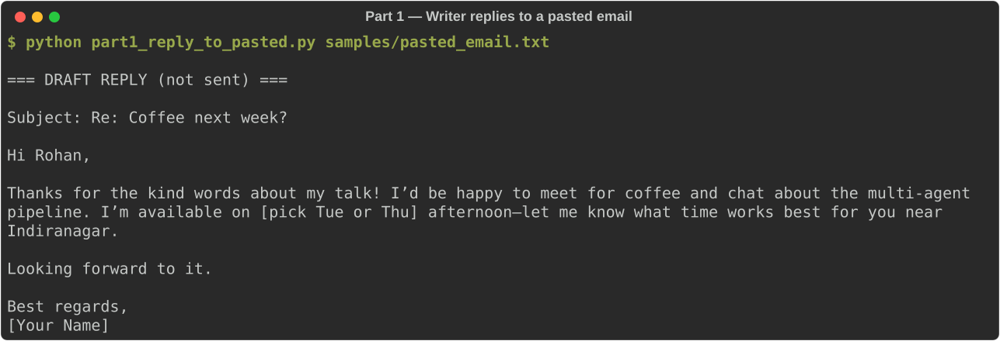
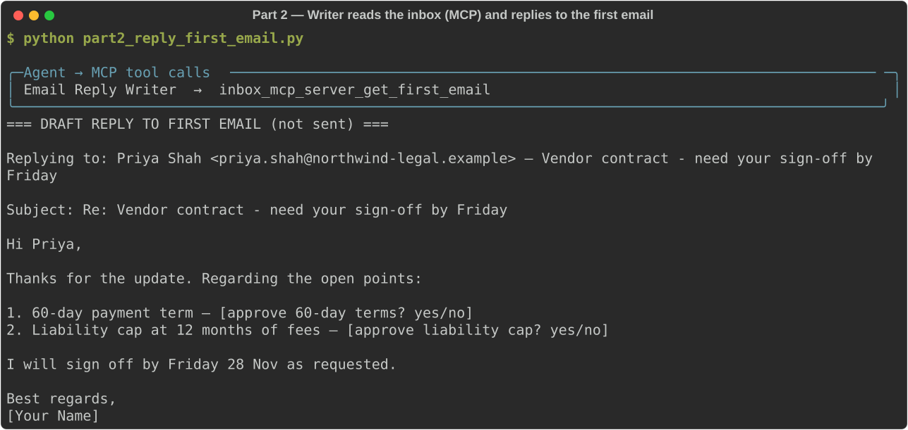
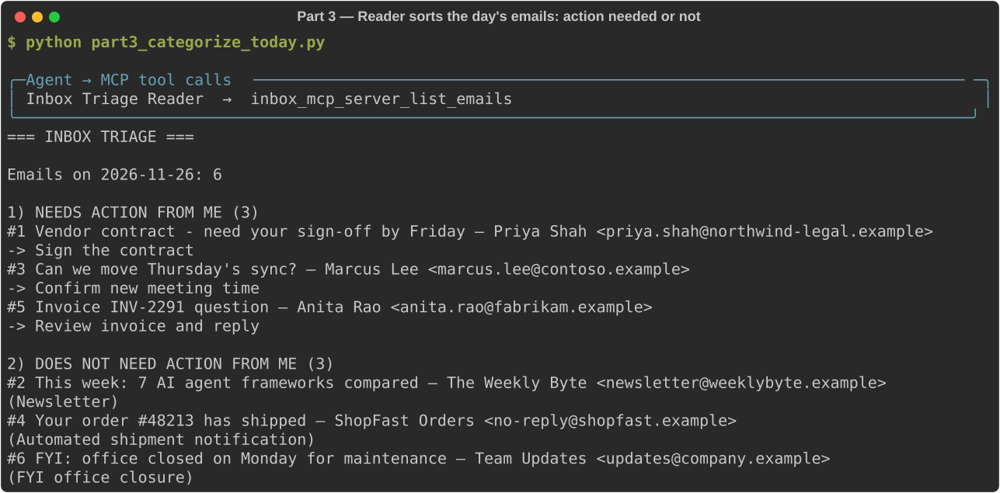
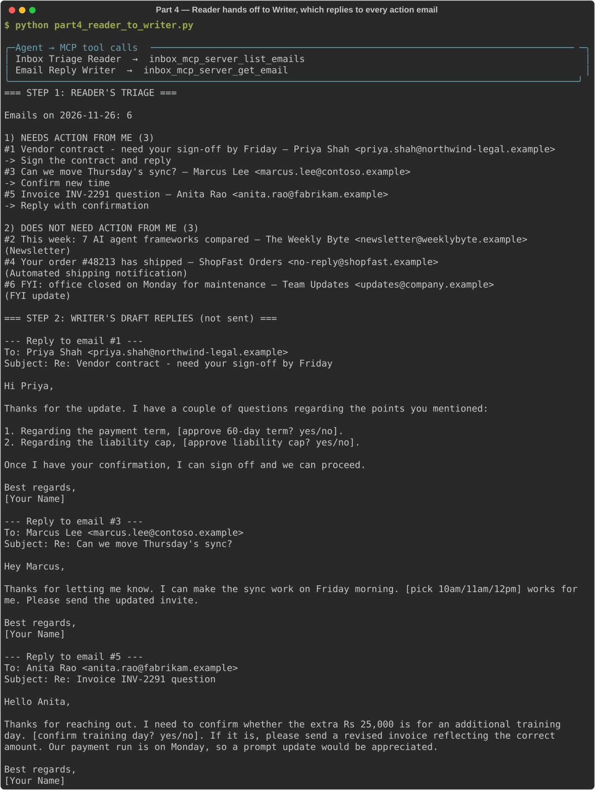

# Email Agents — Reader + Writer with CrewAI and MCP

My Joinloop hackathon #1 project. Two AI agents work through an inbox:

- A **Reader** sorts the day's emails into *needs action from me* and *doesn't need action from me*.
- A **Writer** drafts replies, and the Reader hands it the emails that need action.

The inbox comes from a **PDF export** and is served to the agents by an **MCP server**. The agents never open the PDF themselves, so connecting a live mailbox (Gmail/IMAP) later only means changing that one server file.

**Nothing is ever sent.** Every reply is a draft, and where a reply needs a decision only you can make, the Writer leaves a placeholder like `[pick Tue or Thu]`.

## What's built from the course

| Idea | From | Where it's used here |
|---|---|---|
| Narrow agent roles in a pipeline | Session 3 — Research → Write → Review | `Reader → Writer`, `Process.sequential` |
| Scoped handoff with `Task(context=[...])` | Session 3 — demo 2 | Part 4: the Writer sees only the Reader's triage |
| Structured output | Session 3 | Triage and drafts are Pydantic models |
| MCP server over stdio, tools = functions + docstrings | Session 4 — `mcp_demo_server.py` | `inbox_mcp_server.py` |
| Agent that decides on its own which MCP tool to call | Session 4 — `mcp_agent_demo.py` | The agents call `get_first_email`, `list_emails` and `get_email` themselves |

## How it fits together

```
 sample_inbox.pdf
        │  (read only by the server)
        ▼
 inbox_mcp_server.py ── MCP over stdio ──┐
   tools: inbox_overview, list_emails,   │
          get_email, get_first_email     │
                                         ▼
                     ┌──── CrewAI crew (Groq: gpt-oss-20b) ────┐
                     │  Reader ──context=[triage]──▶ Writer     │
                     │  "needs action?"             draft replies│
                     └─────────────────────────────────────────┘
                                         │
                                         ▼
                          output/*.md  (drafts, never sent)
```

## The 4 parts

| Part | Script | What happens |
|---|---|---|
| 1 | `part1_reply_to_pasted.py` | Paste an email, and the **Writer** drafts a reply. No inbox involved. |
| 2 | `part2_reply_first_email.py` | The **Writer** connects to the inbox through MCP, calls `get_first_email`, and replies to it. |
| 3 | `part3_categorize_today.py` | The **Reader** lists one day's emails through MCP and sorts every one into the two categories. |
| 4 | `part4_reader_to_writer.py` | The **Reader** triages, then hands off to the **Writer**, which fetches each needs-action email and drafts a reply. |

## Screenshots (real test runs)

These were made by `capture.py`, which runs each part against Groq and records the command, every agent → MCP tool call, and the final output.

### Part 1 — reply to a pasted email


### Part 2 — reply to the first inbox email


### Part 3 — sort the day's emails


### Part 4 — Reader → Writer


## Run it yourself

You need Python **3.10–3.13** and a free Groq API key from [console.groq.com](https://console.groq.com).

```bash
python3.12 -m venv .venv && source .venv/bin/activate
pip install -r requirements.txt
cp .env.example .env          # then put your GROQ_API_KEY in .env
```

```bash
python part1_reply_to_pasted.py samples/pasted_email.txt   # or run with no file and paste, then Ctrl-D
python part2_reply_first_email.py
python part3_categorize_today.py
python part4_reader_to_writer.py
```

**Or use the web UI:**

```bash
streamlit run app.py
```

It opens at http://localhost:8501. Pick the sample inbox or upload your own PDF, choose the day, and run any part from its tab. Drafts appear in boxes with a copy button. The UI calls the same agents as the scripts.

**Use your own inbox:** export some emails to a PDF, with each email starting with a `From:` line and followed by `Date:` and `Subject:` lines, then pass it with `--pdf my_inbox.pdf`. `python make_sample_inbox.py` shows the format; it generates the fake `sample_inbox.pdf` used here, and every person and company in it is made up.

**Which day counts as "today":** Parts 3 and 4 default to the newest day in the PDF, because an export is a snapshot. Use `--date today` for the real calendar day, or `--date 2026-11-26` for a specific one.

**Try the MCP server with no LLM:** run `mcp dev inbox_mcp_server.py` and call the tools in MCP Inspector.

**Retake the screenshots:** `python capture.py part1` (or `part2`, `part3`, `part4`).

## Problems I hit (and fixed)

CrewAI 1.15 with MCP on Groq's free tier needed 4 workarounds. All of them are in [`common.py`](common.py):

1. **`cache_breakpoint` is unsupported:** CrewAI adds an internal field to every message, and Groq rejects it. Strip it before each request. This is the same fix as Session 3's demo 2.
2. **`'required' present but 'properties' is missing`:** for MCP tools with no arguments, such as `get_first_email`, CrewAI's schema gets rejected by Groq. Drop the empty `required` list.
3. **Tool names cut off, and the model calling a tool named "python":** CrewAI names stdio MCP tools `<command>_<args>_<tool>` and cuts the result to 64 characters. With full paths, the real tool name was lost. Shortened to `python_m_…`, it made gpt-oss call its own built-in `python` tool. The fix names each server after its script, so tools come out as `inbox_mcp_server_get_email`.
4. **Rate limits:** the free tier allows about 8,000 tokens per minute, and Part 4 goes over that. Groq's error says how long to wait, so the code waits that long and retries.
5. **Unreliable model output:** gpt-oss on Groq sometimes returns output Groq can't parse (`output_parse_failed`), so those requests are retried. In Part 4, the Writer sometimes stops after the first draft, so the script checks its drafts against the Reader's needs-action list and asks again for any it missed. The output shows a `[check]` line when that happens.

## Files

| File | What it is |
|---|---|
| `inbox_mcp_server.py` | MCP server: parses the PDF into emails and serves them as 4 tools |
| `common.py` | LLM setup, the Reader and Writer agents, MCP launch config, Groq workarounds |
| `triage.py` | The Reader's task and its Pydantic output, shared by Parts 3 and 4 |
| `part1_…` – `part4_…` | One script per assignment part; each has a `run()` function the UI calls |
| `app.py` | Streamlit web UI for all 4 parts |
| `capture.py` | Runs a part and saves a screenshot to `screenshots/` |
| `make_sample_inbox.py` | Generates the fake `sample_inbox.pdf` |
| `output/` | Drafts and triage from the latest runs |
