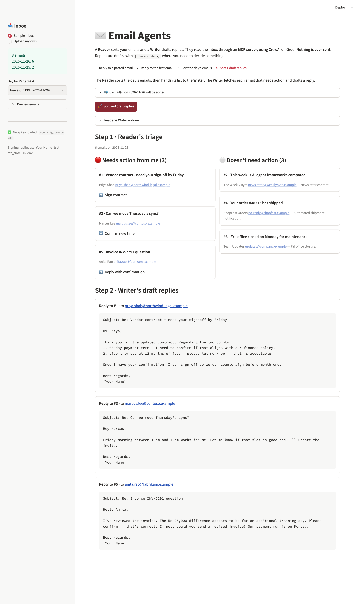
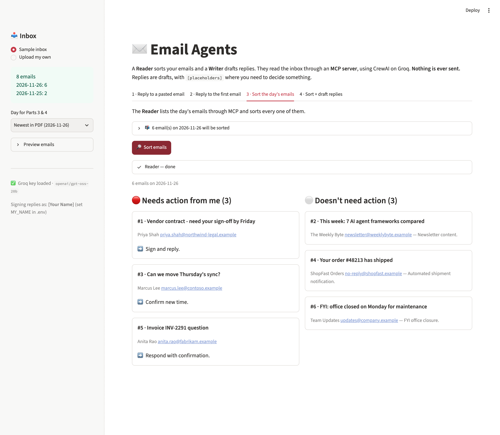
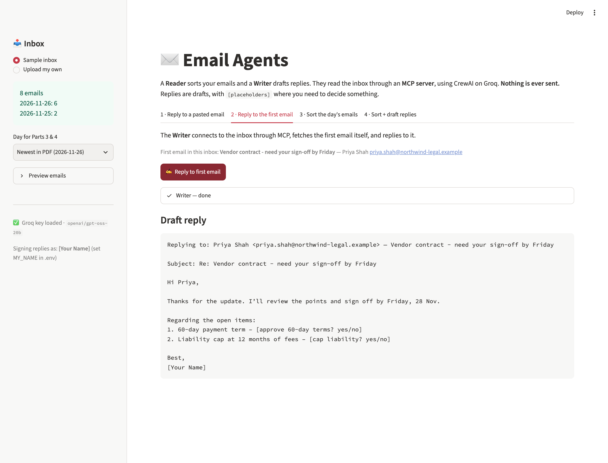
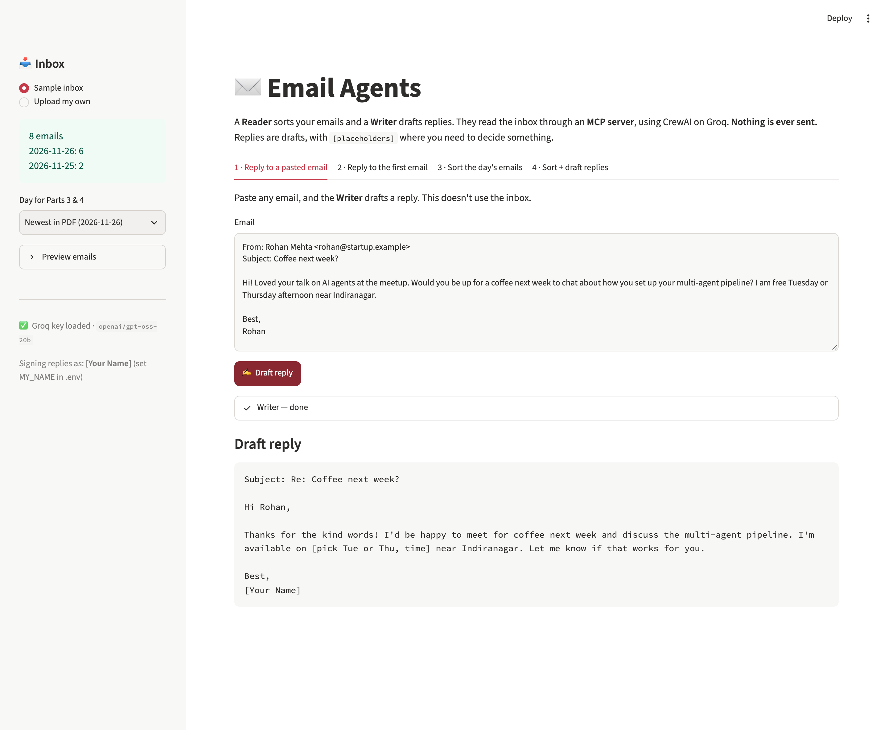

# Email Agents

Two AI assistants that go through your inbox for you:

- The **Reader** looks at the day's emails and sorts them into **needs action from me** and **doesn't need action from me**.
- The **Writer** drafts a reply to each email that needs action.

You give it your inbox as a **PDF**. **Nothing is ever sent:** every reply is a draft for you to check. When a reply needs something only you can decide, like a meeting time or a yes/no, the Writer leaves a gap such as `[pick Tue or Thu]` for you to fill in.

## What it can do

| # | What happens |
|---|---|
| 1 | **Reply to an email you paste in.** The Writer drafts a reply. |
| 2 | **Reply to the first email in your inbox.** The Writer opens the inbox, reads the first email, and drafts a reply. |
| 3 | **Sort the day's emails.** The Reader puts every email from that day into one of the two groups. |
| 4 | **Sort, then reply.** The Reader sorts the day's emails and passes the "needs action" ones to the Writer, which drafts a reply to each. |

In feature 4 both assistants are double-checked. If the Reader misses an email or the Writer misses a reply, it's asked again, and each reply goes to the address that's actually in the email.

## Screenshots (real runs)

### 4 — Sort, then reply


### 3 — Sort the day's emails


### 2 — Reply to the first email


### 1 — Reply to a pasted email


## Run it yourself

You need Python **3.10–3.13** and a free Groq API key from [console.groq.com](https://console.groq.com).

```bash
python3.12 -m venv .venv && source .venv/bin/activate
pip install -r requirements.txt
cp .env.example .env          # then put your GROQ_API_KEY in .env
```

**The easy way, a web page:**

```bash
streamlit run app.py
```

It opens at http://localhost:8501. Pick the sample inbox or upload your own PDF, choose a day, and click the button on any tab. Each draft has a copy button.

**Or from the terminal:**

```bash
python part1_reply_to_pasted.py samples/pasted_email.txt   # or run with no file, paste an email, then Ctrl-D
python part2_reply_first_email.py
python part3_categorize_today.py
python part4_reader_to_writer.py
```

For features 2–4, add `--pdf my_inbox.pdf` to use your own inbox, and for 3–4 add `--date 2026-11-26` to pick a day. Parts 3 and 4 use the **newest day in the PDF** by default, since an exported PDF is a snapshot; `--date today` uses today's date.

## Using your own inbox PDF

Each email in the PDF should start with a `From:` line, followed by `Date:` (or `Sent:`) and `Subject:` lines. `sample_inbox.pdf` shows the format, and `python make_sample_inbox.py` rebuilds it. Everyone in it is made up.

- **Quoted replies are fine.** An earlier email quoted inside a reply stays part of that reply.
- **Most date styles work,** including Gmail's and Outlook's. For US-style dates like `03/04/2026` (4 March), add `INBOX_DATE_ORDER=MDY` to `.env`.
- **Emails with no date** can't be picked by day. The web page warns you about them.
- **Keep each subject on one line.** A subject that wraps onto a second line runs into the email's text.

## How it's built

- **[CrewAI](https://github.com/crewAIInc/crewAI)** runs the two agents in order, Reader then Writer (`Process.sequential`). The Writer's task gets only the Reader's result (`context=[triage]`).
- **An [MCP](https://modelcontextprotocol.io) server** (`inbox_mcp_server.py`) reads the PDF and offers 4 tools: `inbox_overview`, `list_emails`, `get_email` and `get_first_email`. The agents decide for themselves when to use them, and never see the PDF directly. Connecting a live mailbox later only means changing this one file.
- **[Groq](https://groq.com)** runs the model, `gpt-oss-20b`. `common.py` adjusts a few CrewAI requests so Groq accepts them, and waits and retries on Groq's free-tier rate limits.
- **Pydantic models** hold the sorted list and the drafts, so the results can be checked in code.
- **[Streamlit](https://streamlit.io)** is the web page.

To run the tests (no API key needed), run `pytest -q`. To try the inbox tools without any AI, run `mcp dev inbox_mcp_server.py` (needs [Node.js](https://nodejs.org)). To retake the screenshots, start the web page and run `python ui_screenshots.py`.

## Files

| File | What it is |
|---|---|
| `app.py` | The web page |
| `part1_…` – `part4_…` | The 4 features, one script each |
| `inbox_mcp_server.py` | Reads the PDF and serves the emails to the agents |
| `common.py` | The two agents and the model settings |
| `triage.py` | The Reader's sorting task and its double-check |
| `make_sample_inbox.py` | Builds the made-up `sample_inbox.pdf` |
| `ui_screenshots.py` | Retakes the screenshots |
| `tests/` | Basic checks you can run with `pytest -q` |
| `samples/`, `output/` | A sample email to paste, and results from the latest runs |
